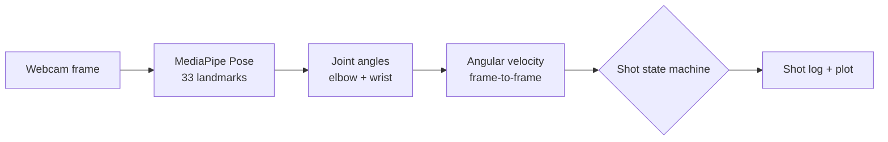

# JumpshotTracker

Real-time basketball shot analysis using computer vision. JumpshotTracker reads a live webcam feed, tracks the shooting arm with pose estimation, measures how fast the elbow and wrist extend, and automatically detects and logs each shot attempt.

Built with Python, OpenCV, MediaPipe Pose, NumPy, and Matplotlib.

---

## What It Does

- Tracks the right shooting arm in real time with MediaPipe Pose
- Calculates the **elbow angle** (shoulder → elbow → wrist) and **wrist angle** (elbow → wrist → index finger) on every frame and draws them on the video
- Computes angular velocity at both joints from frame to frame
- Detects a shot when the elbow and wrist both extend explosively, then records it
- Logs each shot with peak joint velocities, elbow and wrist paths, a per-frame velocity trace, and timing
- Plots elbow angular velocity for every shot at the end of the session

---

## How It Works



1. **Pose estimation.** MediaPipe Pose returns 33 body landmarks per frame. The tracker uses the right shoulder, elbow, wrist, and index finger.
2. **Joint angles.** Each angle comes from the dot product of the two limb vectors meeting at the joint: `θ = arccos((BA · BC) / (|BA| |BC|))`.
3. **Angular velocity.** Velocity is the change in angle between consecutive frames divided by the elapsed time, in degrees per second.
4. **Shot detection.** After a 2-second warm-up, a simple state machine runs on every frame:

| State | Condition | Result |
|---|---|---|
| `IDLE` | elbow ≥ 200°/s **and** wrist ≥ 80°/s | Start a shot (green bar on screen) |
| `IDLE` | some elbow or wrist motion, but not both thresholds | Partial motion (yellow bar) |
| `IN_SHOT` | each frame for 0.8 s | Update peak velocities and record joint paths |
| `IN_SHOT` | 0.8 s elapsed | Save the shot, print it, return to `IDLE` |

---

## Setup

**1. Clone the repo**
```bash
git clone https://github.com/Ravonte-K/jumpshotTracker.git
cd jumpshotTracker
```

**2. Install dependencies**
```bash
pip install -r requirements.txt
```

**3. Run**
```bash
python main.py
```

Stand side-on to the camera with your whole shooting arm in frame. Press `q` to end the session; a velocity plot of all detected shots opens automatically.

### Requirements

- Python 3.10+
- A webcam
- Good lighting, so pose detection stays stable

---

## Output

Each finished shot is printed to the console as a dictionary:

```python
{
  "shot_num": 1,
  "peak_arm_velo": 312.4,       # peak elbow angular velocity, degrees/second
  "peak_wrist_velo": 95.7,      # peak wrist angular velocity, degrees/second
  "timestamp": 1234567890.12,   # Unix time when the shot started
  "elbow_path": [[x, y], ...],  # normalized image coordinates, one per frame
  "wrist_path": [[x, y], ...],
  "arm_velo_frames": [...],     # elbow angular velocity at each frame of the shot
  "duration": 0.81              # seconds; the shot window closes after 0.8 s
}
```

---

## Tech Stack

| Library | Purpose |
|---|---|
| `opencv-python` | Webcam capture, on-screen overlays |
| `mediapipe` | Real-time pose landmark detection |
| `numpy` | Joint angle math |
| `matplotlib` | End-of-session velocity plots |

---

## Current Limitations

- Right-handed shooters only.
- Angles are measured from 2D landmarks, so results depend on camera placement; a side view works best.
- Velocity comes from single-frame differences with no smoothing, so landmark jitter and frame rate affect the numbers.
- The detection thresholds (200°/s, 80°/s, 0.8 s window) were tuned by hand.
- The shot log lasts for one session. It is printed and plotted but not saved to disk yet.

---

## Planned Features

- [ ] Left-hand shooting support
- [ ] Release angle classification (too flat / optimal / too steep)
- [ ] CSV export for multi-session tracking
- [ ] Follow-through consistency scoring

---

## License

MIT
